# 📚 Library Management System

## Overview

A console-based Library Management System developed using Java, JDBC, and MySQL.

This application allows users to manage books, students, and issue/return records efficiently. The system also provides features for tracking overdue books, late returns, and maintaining library inventory.

---

## Features

### Book Management

- Add Books
- View All Books
- Search Book By ID
- Delete Book
- Increase Book Quantity
- Decrease Book Quantity
- Set Overall Quantity

### Student Management

- Add Student
- View All Students
- Search Student By Registration Number
- Delete Student
- Update Student Phone Number
- Update Student Mail ID
- Update Student Year

### Issue & Return Management

- Issue Books
- Return Books
- View All Records
- View Issued Records
- View Returned Records
- View Overdue Records
- View Late Returned Books
- View Records By Student
- View Records By Book

---

## Technologies Used

- Java
- JDBC
- MySQL

---

## Concepts Used

- Object-Oriented Programming (OOP)
- DAO Pattern
- Exception Handling
- Transactions
- PreparedStatement
- Enums
- Input Validation
- Configuration Properties

---

## Project Structure

```text
source
├── DAO
├── model
├── util
└── main
```

---

## Database

Database Name:

```text
library_management
```

---

## Configuration

Create a file named:

```text
config.properties
```

Example:

```properties
db.url=jdbc:mysql://localhost:3306/library_management
db.user=root
db.password=your_password
```

---

---

## Screenshots

### Main Menu

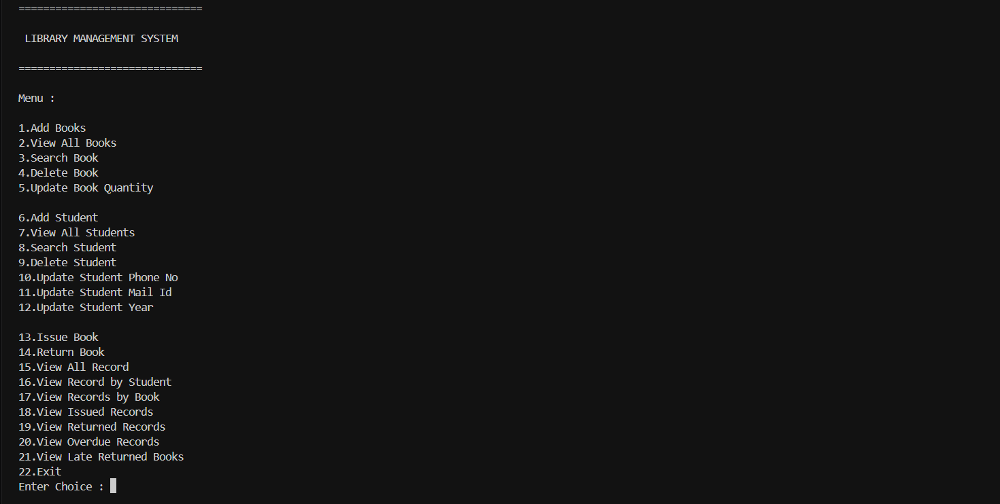

### Add Book

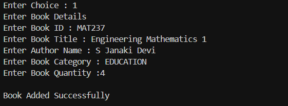

### Add Student

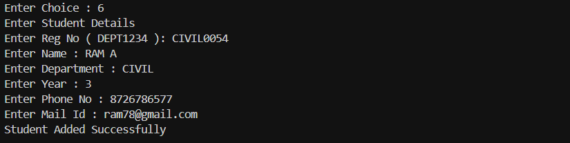

### Issue Book

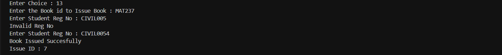

### Return Book

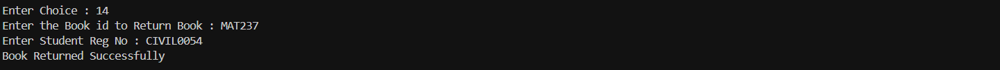

### View Books

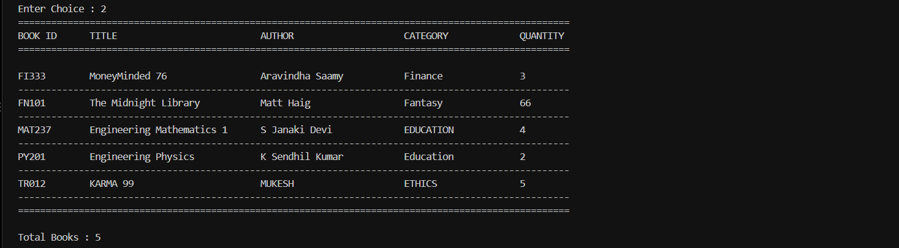

### View Students

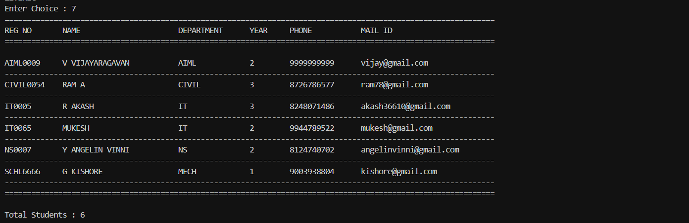

### Issued Books

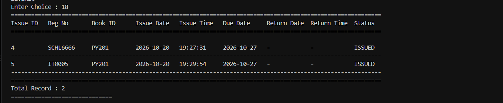

### Returned Books

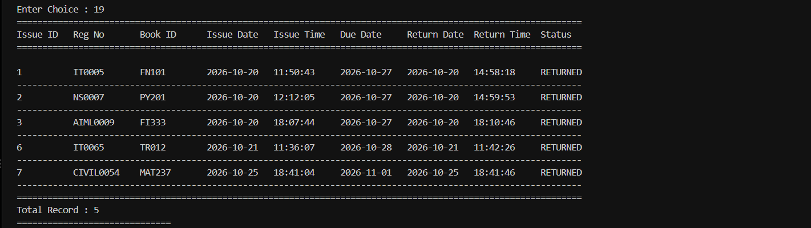

### Student Records

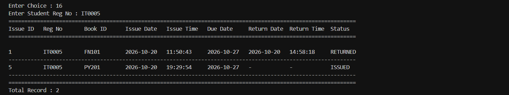

### View Records

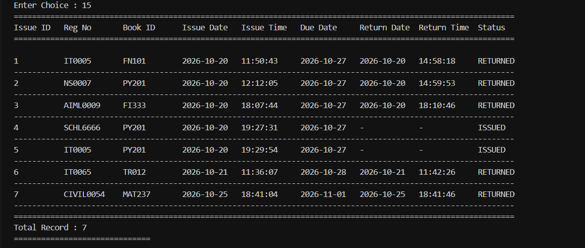
---


## How to Run

1. Clone the repository:

```bash
git clone https://github.com/Akash-36610/library-management-system.git
```

2. Create a MySQL database:

```sql
CREATE DATABASE library_management;
```

3. Create the required tables in the database.

4. Create a file named:

```text
config.properties
```

5. Add your database configuration:

```properties
db.url=jdbc:mysql://localhost:3306/library_management
db.user=root
db.password=your_password
```

6. Add the MySQL JDBC Driver to the `lib` folder.

7. Open the project in VS Code or any Java IDE.

8. Compile and run:

```text
Main.java
```

9. Use the menu-driven interface to manage books, students, and issue/return records.

---

## Author

**R Akash**  

GitHub: https://github.com/Akash-36610

---